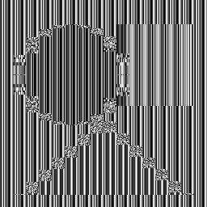

# NAMA_ALGORITMA

Block cipher 128-bit rancangan Kelompok 15 untuk Tugas 2 IF4020 Kriptografi ITB 2026/2027 ("Membuat Block
Cipher Baru"), lengkap dengan aplikasi CLI untuk mengenkripsi dan mendekripsi berkas apa pun di lima mode
operasi, dengan jaminan integritas data.

- **Cipher:** jaringan Feistel 16 round, blok 128 bit, kunci 128 bit. Fungsi putaran F terinspirasi
  modulasi sigma-delta (ΣΔ): akumulator penjumlahan mod 2³², S-box 8-bit sebagai "quantizer", dan
  umpan balik antar-word. F dijalankan maju lalu mundur dengan rotasi di antaranya, dan diakhiri
  permutasi bit.
- **Mode operasi:** ECB, CBC, CFB (128-bit), OFB, CTR (counter 128-bit). ECB, CTR, serta dekripsi
  CBC/CFB diparalelkan dengan OpenMP.
- **Padding:** PKCS#7 untuk ECB dan CBC. CFB, OFB, dan CTR tanpa padding (stream-like).
- **Integritas:** CMAC (RFC 4493) dengan skema Encrypt-then-MAC, kunci enkripsi dan kunci MAC
  diturunkan terpisah dari master key, tag diverifikasi (constant-time) sebelum dekripsi.
- **Tanpa pustaka kriptografi pihak ketiga.** Cipher, mode, padding, dan CMAC semuanya ditulis sendiri.

## Tech stack

| Komponen | Teknologi |
|---|---|
| Bahasa | C++17 |
| Compiler / build | g++ (diuji 13.3), GNU Make |
| Paralelisasi | OpenMP (opsional, `make OMP=0` untuk mematikan) |
| Pengujian | Unit test C++ (`tests/test_*.cpp`), Bash (`tests/e2e.sh`, `tests/run_all.sh`) |
| Analisis | C++ (`analysis/`, `tools/`), Python 3 tanpa pustaka eksternal untuk grafik |
| Dokumentasi API | Doxygen, di-host lewat GitHub Pages (GitHub Actions) |

## Dependensi

Program berjalan di **Linux** atau **Windows lewat WSL** (memakai `getentropy` dan POSIX I/O, jadi tidak
bisa di-build native dengan MinGW/MSVC).

| Kebutuhan | Untuk | Paket Ubuntu/Debian |
|---|---|---|
| g++ ≥ 9 (C++17), make | build | `build-essential` |
| libgomp | OpenMP (biasanya ikut g++) | `libgomp1` |
| python3 | `make test-e2e` (timing) dan `make results` (grafik, demo gambar) | `python3` |
| coreutils, `xxd` (opsional) | e2e, inspeksi berkas | `coreutils`, `xxd` |
| doxygen (opsional) | `make docs` | `doxygen` |

```bash
sudo apt-get install build-essential python3 xxd doxygen
```

## Build

```bash
git clone https://github.com/reletz/IF4020-15-Tugas2.git
cd IF4020-15-Tugas2
make            # menghasilkan build/cipher_cli dan menyalinnya ke ./cipher_cli
make OMP=0      # build tanpa OpenMP
```

Binary `cipher_cli` di root repo adalah hasil build Linux x86-64 (butuh `libstdc++` dan `libgomp`).
Kalau tidak jalan di mesinmu, build ulang dengan `make`.

> Checkout di Windows lalu menjalankan di WSL: clone di filesystem WSL (`~/...`) supaya lebih cepat.
> `.gitattributes` sudah memaksa skrip `.sh` memakai LF.

## Cara menjalankan

```text
cipher_cli encrypt [-f] -m <ecb|cbc|cfb|ofb|ctr> (-k <32 hex> | --key-file <path>) [--iv <32 hex>] (-i <in> | -t <teks>) -o <out>
cipher_cli decrypt [-f] (-k <32 hex> | --key-file <path>) -i <in> -o <out>
cipher_cli keygen  [-f] -o <path>
cipher_cli --help
```

| Opsi | Arti |
|---|---|
| `-m` | Mode operasi (hanya encrypt). Saat decrypt, mode dibaca dari header berkas |
| `-k` / `--key-file` | Master key 128 bit sebagai 32 karakter heksadesimal, langsung atau dari berkas |
| `--iv` | IV / counter awal 16 byte (32 hex). Default: acak dari CSPRNG OS. Tidak dipakai di ECB |
| `-i` / `-t` | Berkas masukan (teks atau biner apa pun) atau teks langsung |
| `-o` | Berkas keluaran |
| `-f` | Izinkan menimpa berkas keluaran |

Contoh:

```bash
./cipher_cli keygen -o secret.key                                          # kunci acak (permission 0600)
./cipher_cli encrypt -m cbc --key-file secret.key -i laporan.pdf -o laporan.enc
./cipher_cli decrypt --key-file secret.key -i laporan.enc -o laporan.pdf
./cipher_cli encrypt -m ctr -k 000102030405060708090a0b0c0d0e0f \
    --iv 0f0e0d0c0b0a09080706050403020100 -t "Pesan rahasia" -o pesan.enc
```

| Exit code | Arti |
|---|---|
| 0 | Berhasil |
| 1 | Argumen salah |
| 2 | Error I/O (berkas tidak ada, gagal menulis) |
| 3 | Berkas bukan kontainer yang valid, atau padding rusak |
| 4 | Verifikasi integritas gagal: berkas diubah atau kunci salah (tidak ada berkas output) |

### Format berkas terenkripsi

| Offset | Panjang | Isi |
|---|---|---|
| 0 | 4 | Magic `IF15` |
| 4 | 1 | Versi `0x01` |
| 5 | 1 | Mode: 1 ECB, 2 CBC, 3 CFB, 4 OFB, 5 CTR |
| 6 | 16 | IV / counter awal (nol untuk ECB) |
| 22 | m | Ciphertext |
| 22 + m | 16 | Tag CMAC atas seluruh byte sebelumnya |

## Pengujian dan analisis

| Perintah | Isi |
|---|---|
| `make test` | Semua unit test (cipher, permutasi, padding, mode, CMAC, kontainer, utilitas) |
| `make test-e2e` | 60 cek end-to-end lewat CLI: round-trip 5 mode (0 B sampai 16 MiB), tamper, kunci salah, truncation, IV freshness, pola ECB |
| `make avalanche` | Avalanche satu blok (1 bit plaintext / kunci) |
| `make sac` | Strict Avalanche Criterion 128 × 128 |
| `make rounds` | Avalanche per jumlah round 1–16 |
| `make analyze` | Kualitas S-box (nonlinearity, differential uniformity, derajat aljabar, SAC) |
| `make mode-analysis` | Analisis **5 mode**: bukti padding, avalanche (plaintext/kunci/IV), entropi, chi-square, keunikan blok, histogram (CSV) |
| `make bench` / `make bench-csv` | Throughput mode serial vs paralel |
| `make results` | Semua tes dan analisis di atas, hasilnya disimpan ke [`test-results/`](test-results/) |

Ringkasan hasil (detail dan tabel lengkap di [`test-results/README.md`](test-results/README.md)):

| Uji | Hasil |
|---|---|
| Unit test | 2108 cek lulus, plus `test_permutation` dan `test_roundtrip` PASS |
| End-to-end | 60/60 lulus |
| Avalanche 1 blok | 49,99% (plaintext), 49,99% (kunci) |
| SAC | 50,00%, 0 dari 16.384 sel menyimpang > 4σ |
| Difusi penuh | tercapai di round 4 dari 16 |
| Entropi ciphertext (1 MiB) | 7,9998 bit/byte untuk CBC/CFB/OFB/CTR. ECB turun (3,92–7,97) pada input berpola |
| Chi-square | CBC/CFB/OFB/CTR seragam (113/120 run lolos 5%). ECB gagal pada input berpola |
| Avalanche per mode | 1 bit kunci / IV → sekitar 50% di semua mode. 1 bit plaintext → sekitar 50% (ECB/CBC), 1 bit (OFB/CTR) |

| Plaintext | ECB | CBC | CTR |
|---|---|---|---|
|  |  |  |  |

## Dokumentasi API

Dokumentasi API (deskripsi, parameter masukan/keluaran beserta tipe data, contoh penggunaan) dibangkitkan
dengan Doxygen dari komentar di `include/*.hpp`, dengan halaman utama
[`docs/api/mainpage.md`](docs/api/mainpage.md).

- Online: https://reletz.github.io/IF4020-15-Tugas2/ (terbit otomatis lewat `.github/workflows/docs.yml`
  setelah GitHub Pages diaktifkan dengan sumber "GitHub Actions")
- Lokal: `make docs`, lalu buka `build/html/index.html`

## Struktur repositori

```text
include/        header + dokumentasi API (Doxygen)
src/core/       inti cipher: Feistel, fungsi F, key schedule, S-box, permutasi
src/ops/        mode operasi, padding, CMAC, kontainer
src/util/       hex, byte, CSPRNG, I/O berkas
src/main.cpp    aplikasi CLI
tests/          unit test, e2e.sh, run_all.sh
analysis/       avalanche, SAC, avalanche per round, analisis 5 mode, benchmark, grafik
tools/          generator dan analisis S-box
test-results/   berkas uji dan hasil pengujian
docs/           rancangan (plan.md), laporan LaTeX, halaman utama API doc
```

## Kelompok 15

| Nama | NIM |
|---|---|
| Dita Maheswari | 13523125 |
| Naufarrel Zhafif Abhista | 13523149 |
| I Made Wiweka Putera | 13523156 |
| Hasri Fayadh Muqaffa | 13523160 |
