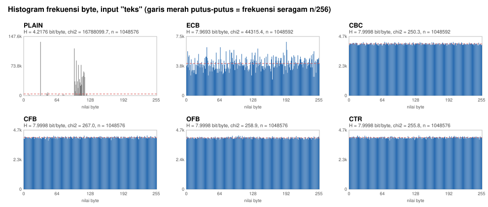
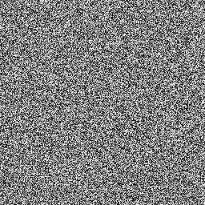
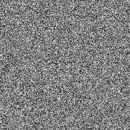

# Berkas uji dan hasil pengujian

Folder ini berisi berkas uji dan seluruh hasil pengujian.
Semua isi, kecuali `samples/teks.txt`, dibangkitkan ulang dengan:

```bash
make results                    # semua tes + analisis, sekitar 3 menit
SKIP_TESTS=1 make results       # hanya analisis (tanpa unit test dan e2e)
```

Data uji, kunci, dan IV pada analisis memakai seed tetap, jadi angka di bawah bisa direproduksi.
Pengecualiannya `logs/e2e.log`, yang memakai data acak dan mencatat waktu benchmark mesin.
Hasil di folder ini dibuat di WSL2 Ubuntu 24.04, g++ 13.3, AMD Ryzen 5 4600H (12 thread), 9 Oktober 2026.

## Isi folder

| Path | Isi |
|---|---|
| `samples/teks.txt` | Berkas uji teks (1116 B, bukan kelipatan 16, ada karakter non-ASCII) |
| `samples/gambar.png` | Berkas uji biner (PNG 949 B), sama dengan gambar di `ecb_image/plain.png` |
| `cli/*.enc` | Hasil enkripsi kedua berkas uji di 5 mode lewat `cipher_cli` (kunci uji `000102…0e0f`, IV `0f0e…0100`) |
| `cli/roundtrip.md` | Tabel round-trip (ukuran, payload, dekripsi identik) dan verifikasi integritas |
| `logs/unit.log` | `make test`: semua unit test |
| `logs/e2e.log` | `tests/e2e.sh`: 60 cek end-to-end lewat CLI |
| `logs/avalanche.log`, `logs/sac.log` | Avalanche dan SAC satu blok |
| `logs/rounds.log`, `data/avalanche_rounds.csv` | Avalanche per jumlah round (1–16) |
| `logs/sbox.log` | Analisis S-box (NL, DU, derajat aljabar, SAC) |
| `logs/modes.log` | Analisis 5 mode: bukti padding, avalanche per mode, entropi, chi-square, keunikan blok |
| `data/avalanche_modes.csv` | Avalanche per mode (CSV) |
| `data/entropy_modes.csv` | Entropi, chi-square, p-value, byte unik, blok unik per input × mode (CSV) |
| `data/hist_{teks,nol,pola}.csv` | Frekuensi 256 nilai byte plaintext dan ciphertext 5 mode |
| `plots/hist_{teks,nol,pola}.svg` | Grafik histogram plaintext vs 5 mode |
| `ecb_image/*.png` | Demo visual: gambar yang sama dienkripsi di 5 mode |

Hasil benchmark serial vs paralel ada di `docs/report/data/bench.csv` (`make bench-csv`).

## Ringkasan hasil

### Unit test dan end-to-end

| Suite | Hasil |
|---|---|
| `test_container` | 784 lulus, 0 gagal |
| `test_mac` | 1011 lulus, 0 gagal |
| `test_modes` | 148 lulus, 0 gagal |
| `test_padding` | 133 lulus, 0 gagal |
| `test_util` | 32 lulus, 0 gagal |
| `test_permutation`, `test_roundtrip` | PASS |
| `tests/e2e.sh` | 60 cek lulus |

### Round-trip berkas uji

Teks (1116 B) dan biner (949 B) di 5 mode: semua hasil dekripsi identik dengan aslinya. Payload ECB/CBC
dibulatkan ke kelipatan 16 berikutnya (1120 B dan 960 B) karena padding PKCS#7, sedangkan CFB/OFB/CTR
sama panjang dengan plaintext. Ubah 1 bit ciphertext dan pakai kunci salah sama-sama ditolak (exit 4)
tanpa membuat berkas output. Detail: [`cli/roundtrip.md`](cli/roundtrip.md).

### Avalanche dan SAC satu blok

| Uji | Rata-rata | Min–max |
|---|---|---|
| 1 bit plaintext (1000 × 128) | 49,99% | 27,34–69,53% |
| 1 bit kunci (1000 × 128) | 49,99% | 28,91–68,75% |
| SAC plaintext → ciphertext (128 × 128 sel, 2000 percobaan) | 50,00% | 45,75–54,30%, 0 sel di luar 4σ |
| SAC kunci → ciphertext | 49,99% | 45,70–54,20%, 0 sel di luar 4σ |

### Avalanche per jumlah round

| Round | 1 bit plaintext | 1 bit kunci |
|---|---|---|
| 1 | 8,48% | 21,15% |
| 2 | 28,32% | 46,14% |
| 3 | 45,21% | 49,97% |
| 4 | 49,98% | 49,99% |
| 16 | 49,99% | 50,00% |

Difusi penuh tercapai di round 4 (kunci di round 3). Dengan 16 round, margin keamanannya 4× dari
titik itu.

### Avalanche per mode (pesan 64 blok, 500 percobaan per mode)

| Mode | 1 bit pt: blok sebelum | blok yang sama | blok sesudah | 1 bit kunci | 1 bit IV |
|---|---|---|---|---|---|
| ECB | 0% | 50,16% | 0% | 49,98% | tidak dipakai |
| CBC | 0% | 49,71% | 50,01% | 50,02% | 49,96% |
| CFB | 0% | 0,78% (1 bit) | 49,93% | 49,99% | 50,00% |
| OFB | 0% | 0,78% (1 bit) | 0% | 49,99% | 49,97% |
| CTR | 0% | 0,78% (1 bit) | 0% | 49,95% | 49,98% |

Perubahan 1 bit plaintext di CFB/OFB/CTR hanya membalik 1 bit ciphertext di posisi yang sama (0,78% =
1/128), karena plaintext di-XOR dengan keystream. Itu sifat mode stream, bukan kelemahan cipher.
Perubahan 1 bit kunci atau IV tetap mengubah sekitar 50% seluruh ciphertext di semua mode.

### Entropi dan chi-square (1 MiB per input, rata-rata 10 kunci/IV)

Entropi maksimum 8 bit/byte. Chi-square df = 255: data seragam bernilai sekitar 255 ± 45, lolos jika p ≥ 0,05.

| Input | Plaintext | ECB | CBC | CFB | OFB | CTR |
|---|---|---|---|---|---|---|
| teks berulang: entropi | 4,2176 | 7,9693 | 7,9998 | 7,9998 | 7,9998 | 7,9998 |
| teks berulang: χ² | 16.788.100 | 44.315 | 250,4 | 267,0 | 258,9 | 255,8 |
| semua nol: entropi | 0,0000 | 3,9205 | 7,9998 | 7,9998 | 7,9998 | 7,9998 |
| semua nol: χ² | 267.386.880 | 17.196.378 | 239,0 | 255,9 | 250,5 | 259,6 |
| pola 0..255: entropi | 8,0000 | 7,1834 | 7,9998 | 7,9998 | 7,9998 | 7,9998 |
| pola 0..255: χ² | 0,0 | 1.040.368 | 262,6 | 241,0 | 253,7 | 258,9 |
| blok 16 B unik | < 0,6% | < 0,6% | 100% | 100% | 100% | 100% |

- CBC, CFB, OFB, dan CTR menghasilkan ciphertext yang secara statistik seragam untuk ketiga input.
  Dari 120 run, 113 lolos uji χ² 5% (5,8% gagal). Angka ini sesuai harapan untuk data benar-benar
  acak, yang memang gagal sekitar 5% secara kebetulan.
- ECB gagal di semua input berpola, karena blok plaintext yang sama menghasilkan blok ciphertext
  yang sama (blok unik tetap < 0,6%).
- Input "pola" menunjukkan bahwa entropi saja tidak cukup: plaintext-nya punya entropi 8,0 (semua
  byte muncul sama sering) padahal sama sekali tidak acak. χ² dan keunikan blok menangkap hal ini.

Grafik histogram: [`plots/hist_teks.svg`](plots/hist_teks.svg), [`plots/hist_nol.svg`](plots/hist_nol.svg),
[`plots/hist_pola.svg`](plots/hist_pola.svg).



### Demo gambar ECB

Gambar grayscale 256 × 256 (1 byte per piksel, jadi 1 blok = 16 piksel) dienkripsi di setiap mode, lalu
ciphertext-nya ditampilkan lagi sebagai gambar.

| Plaintext | ECB | CBC | CFB | OFB | CTR |
|---|---|---|---|---|---|
|  |  |  |  |  |  |

Bentuk gambar masih terlihat di ECB, sedangkan keempat mode lain tampak seperti noise.

### S-box

| Metrik | S-box ini | AES |
|---|---|---|
| Bijektif, fixed point | ya, 0 | ya, 0 |
| Nonlinearity | 98 | 112 |
| Differential uniformity | 10 | 4 |
| Derajat aljabar komponen | 6–7 | 7 |
| SAC rata-rata (min–max) | 0,499 (0,391–0,594) | ~0,5 |

Nilainya tipikal untuk S-box acak terpilih: lebih lemah dari S-box AES yang dikonstruksi secara aljabar.
Kekurangan ini dikompensasi oleh 16 lookup S-box per round dan 16 round (lihat avalanche per round).
